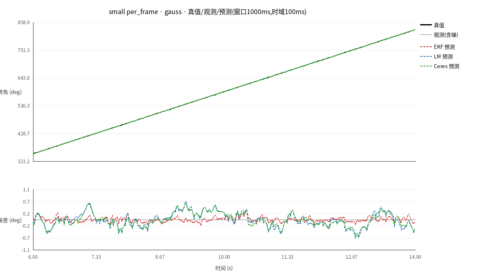
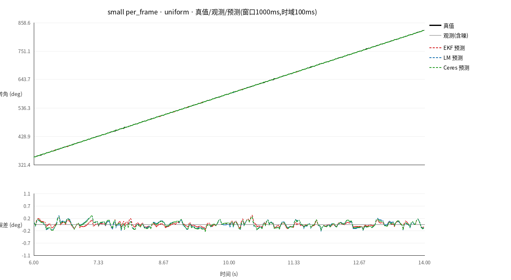
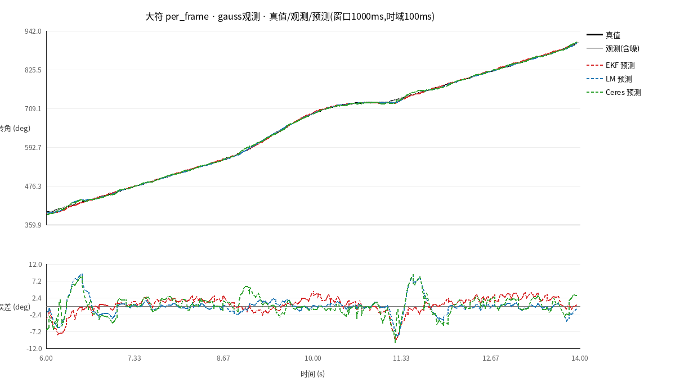
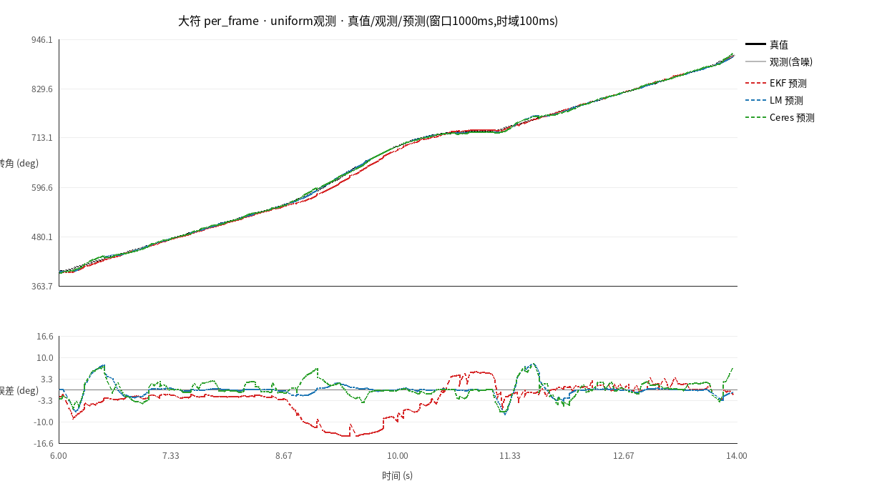
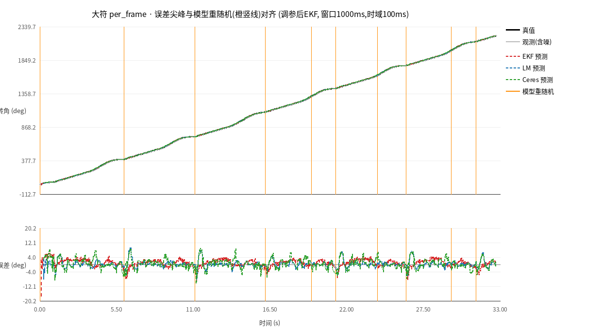
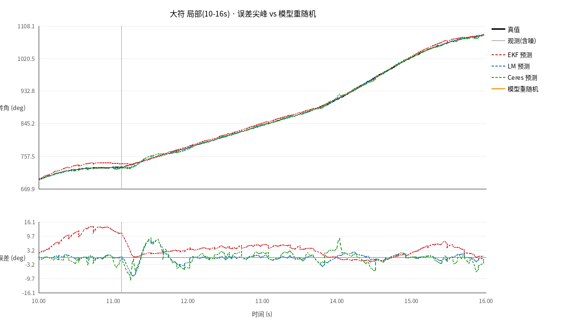

# 能量机关转角预测：运动规律、三种方法与评估结果

本文件对应"用已有数据序列做滑动窗口预测，评估 EKF / LM / Ceres 三种方法"的工作。
评估基准是模拟器真值（`angle_truth_unwrap_rad`）。

---

## 1. 运动规律（大小符角度变化公式）

**权威来源**：`RP-26Rune/src/core/algorithm/power_rune/include/common/power_rune_global.hpp`
的 `BigRuneMotionModelParams` 注释；配置默认值见
`RP-26Rune/.../docs/power_rune.jsonc`；EKF 实现见
`sp_vision_25/tasks/auto_buff/buff_predict.hpp`。

### 小符（Small）
恒定角速度，仅需一个角速度：

```
ω_small = 1.0472 rad/s = π/3 = 60°/s
φ(t) = φ0 + s·ω_small·t          s = ±1（顺/逆时针）
```

### 大符（Large）
角速度按正弦变化（规则给定），转角为其积分：

```
spd(t) = a·sin(ω·t + δ) + b
a ∈ (0.78, 1.045)     角速度振幅
ω ∈ (1.884, 2.000)    转速振动角频率
b  = 2.090 − a        恒定分量,  2.090 rad/s = 120°/s
δ ∈ (0, 2π)           初相位

φ(t) = −(a/ω)·cos(ω·t + δ) + b·t + C
     = A·cos(ω·t) + B·sin(ω·t) + b·t + C
A = −(a/ω)·cosδ ,  B = (a/ω)·sinδ ,  b = 2.090 − a
且满足  ω·√(A² + B²) + b = 2.090
```

即：**大符转角 = 余弦/正弦项 + 线性项 + 常数项**，共 5 个参数 (A,B,b,C,ω)；
小符是其退化情形（a→0，只剩线性项）。

**用本工作空间采集到的真值核验**（脚本见 `scripts/`）：
* 小符整段线性拟合 斜率 1.0473 rad/s（=60.00°/s），RMSE 0.0015 rad；
* 大符按上式拟合，模拟器在线真值同时直接给出 `sin_amplitude=a, sin_omega=ω,
  sin_offset=2.090−a`，各分段内角度 RMSE < 1°。
* 注意：模拟器的大符 (a,ω) 会**周期性重新随机并重置相位计时**（本机约每 2.5s 一次），
  所以大符真值在重随机处会有速度跳变；滑动窗口内应视为分段常数。

---

## 2. 三种方法

| 方法 | 模型 | 求解方式 |
|---|---|---|
| **EKF** | 小符：1 维（恒定 ω=π/3）；大符：5 维 `[angle,spd,a,ω,δ]` | 扩展卡尔曼滤波，状态递归（移植 `buff_predict.hpp`） |
| **LM** | 大符：`A·cos(ωt)+B·sin(ωt)+bt+C`；小符：`kt+c` | LM 模块的 IRLS（时间权重+Cauchy 鲁棒权重）拟合；大符再外层用 LM 迭代 ω∈[1.884,2.0]（移植 `LM_IRLS_BigRunePhaseMotionFilter.cpp`）。**小符也用 LM** |
| **Ceres** | 与 LM 相同 | Ceres Solver 自动微分非线性最小二乘，ω 加 [1.884,2.0] 边界（`third_party/ceres-root`） |

* EKF 按原始实现**连续递归**运行；LM / Ceres 是**滑动时间窗拟合并外推**。
* 代码：`src/ekf_predictor.hpp`、`src/lm_predictor.hpp`、`src/ceres_predictor.hpp`，
  评估主程序 `src/predict_eval.cpp`。

---

## 3. 评估协议

* 数据：`data/wallclock_5ms/`（严格 5ms 采样，1000 点）与 `data/per_frame/`
  （逐帧，≈33ms，1000 点），小符 / 大符，红方；观测序列取 高斯 / 均匀 / 合成。
  *重要*：5ms 数据是模拟器约 29Hz 真值的"阶梯"重采样，`per_frame` 是逐帧平滑序列。
* 条件：预测时域 H ∈ {20,40,60,100,150,200} ms；拟合窗口 ∈ {200,500,1000,2000} ms。
* 指标：以目标样本时刻真值为基准，`RMSE° / MAE° / Max°`。
* **暖机**：统计时默认跳过序列开头 1000ms（`--warmup-ms`）——EKF 是递归滤波器，冷启动前若干帧
  旋向尚未确定（见第 8 节），会把整段 RMSE 带偏；跳过暖机对三种方法一视同仁。
* 复现：`scripts/build.sh && scripts/run_eval.sh`（结果 `results/metrics_all.csv`），
  画图 `scripts/plot_results.py`（`results/rmse_vs_horizon.svg`）。

---

## 4. 结果（RMSE°，高斯观测，窗口=1000ms）

（暖机 1000ms，窗口 1000ms，高斯观测）

| 数据 | 模式 | 时域H | EKF | LM | Ceres |
|---|---|---|---|---|---|
| per_frame | 小符 | 100ms | **0.101** | 0.249 | 0.229 |
| per_frame | 小符 | 200ms | **0.102** | 0.278 | 0.253 |
| per_frame | 大符 | 100ms | 2.116 | **1.988** | 2.654 |
| per_frame | 大符 | 200ms | 4.222 | **4.032** | 4.760 |
| 5ms | 小符 | 100ms | 0.643 | **0.630** | 0.631 |
| 5ms | 小符 | 200ms | 0.649 | 0.638 | **0.638** |
| 5ms | 大符 | 100ms | 2.543 | **1.996** | 2.586 |
| 5ms | 大符 | 200ms | 5.094 | **3.931** | 4.450 |

（加粗 = 最优。小符的 LM 用 IRLS 鲁棒加权、Ceres 用纯最小二乘，故两者数值略有差别。）

### 主要结论
1. **小符**：模型简单（恒定角速度）。`per_frame` 平滑数据上 **EKF 明显最优**
   （0.101° vs LM 0.249° / Ceres 0.229°）；`5ms` 阶梯数据上三者相当（≈0.63°）。
   ——之前"小符 EKF 更差"是**冷启动**导致的假象，见第 8 节。
2. **大符**：正弦模型参数多、可辨识性差。**EKF 调快收敛后**（见第 9 节），
   `per_frame` 上 EKF 与 LM 基本持平（2.12° vs 1.99°），均优于 Ceres（2.65°）；
   `5ms` 上 LM 最优（2.00°），EKF/Ceres 相当（2.54°/2.59°）。
3. **窗口长度**：`per_frame/小符` 窗口越长越好（200→2000ms：0.70°→0.19°）；
   但大符窗口过长（>1000ms）会跨过模拟器的模型重随机点，误差反弹（见
   `per_frame/大符` Ceres 2.7°→7.5°）。
4. **噪声**：三方法对高斯/均匀/合成噪声的量级都随噪声增大而增大；误差主要由
   观测噪声主导，模型误差次之。
5. **EKF 的一个脆弱点**：其顺/逆旋向判别用相邻帧上下计数（`cw_ccw`），当**单步真实
   转角小于噪声**时（本工作 5ms 阶梯数据即是），计数可能被噪声带偏。实测 `5ms/小符`
   EKF 在均匀噪声下 RMSE 8.1°、而高斯噪声下 1.6°——同一方法不同噪声实现差异巨大，
   说明旋向判别不稳定。

（`results/rmse_vs_horizon.svg` 给出四个"数据×模式"面板的 RMSE-时域曲线。）

---

## 5. 复现命令

```bash
cd 预测评估
./scripts/build.sh
./scripts/run_eval.sh                       # 生成 results/metrics_all.csv
python3 scripts/plot_results.py             # 生成 results/rmse_vs_horizon.svg
```

`third_party/ceres-root/` 是本地 vendored 的 Ceres 2.2.0（含头文件与库，无需 root 安装），
构建脚本通过 `-Wl,--disable-new-dtags -Wl,-rpath,...` 静态指定其依赖路径。

---

## 6. 真值 vs 预测 曲线图（预测输入=带噪观测序列）

`predict_eval --dump-pred` 导出逐锚点曲线：**EKF / LM / Ceres 的预测输入都是带噪声的
观测序列**（`angle_obs_*_unwrap_rad`），真值仅用于算误差。可用 `--series gauss|uniform|combined`
选择噪声分布。`scripts/plot_curves.py` 用 PIL 画成 PNG（上栏：真值/观测/预测曲线叠加；
下栏：预测−真值 的误差，便于看清很小的偏差）。

四张图（小/大符 × 高斯/均匀，per_frame，窗口1000ms，时域100ms）：






各图（全序列）RMSE：

| 图 | EKF | LM | Ceres |
|---|---|---|---|
| 小符·高斯 | 0.413 | 0.264 | **0.239** |
| 小符·均匀 | 0.413 | 0.109 | **0.105** |
| 大符·高斯 | 4.925 | **2.023** | 2.738 |
| 大符·均匀 | 4.923 | **1.793** | 2.480 |

```bash
# 任意条件: <csv> <small|large> <窗口ms> <时域ms> <gauss|uniform|combined> <t0> <t1> <out.png> [标题]
./scripts/plot_condition.sh data/per_frame/rune_small_sequences.csv small 1000 100 gauss 6 14 results/curve_small_gauss.png "小符"
```

（中文字体已修复：脚本优先加载 `NotoSansCJK-Regular.ttc` 渲染中文，避免方框乱码。）

---

## 7. 为什么误差会周期性变大？（不是角度的问题）

**现象**：大符误差每隔几秒出现尖峰，且 EKF / LM / Ceres 三种方法同时出现。

**排查与证据**：

1. **不是 4π 回绕（角度问题）**。真值和观测都用的是 `*_unwrap_rad` 展开列；实测回绕点
   （如小符 t=6.18/18.19/30.19s）前后观测展开值连续（Δ≈0.03 rad），且回绕约每 10.7s 一次，
   与尖峰周期不符。
2. **小符对照 = 无此现象**。小符恒定 60°/s，速度跳变检测为 **0 次**，误差平稳
   （中位 0.14°，仅起始暖机略高）→ 说明"周期性变大"只与大符有关。
3. **大符存在周期性"模型重随机"**。对大符真值角速度做差分，检测到周期性**速度跳变**
   （时间点见 `results/curve_large_cause.png` 橙色竖线）：模拟器**每隔约 5s 重新随机大符的
   转速参数 (a, ω) 并把相位计时 `relative_time` 归零**，导致角速度不连续。
4. **定量相关**：按"距上次速度跳变的时间"统计平均绝对误差——
   0–0.5s 内 **2.93°**，随时间衰减到 >3s 后的 **2.03°**。即误差在模型重随机后立即变大，
   随后随滑动窗口滑过、旧数据被淘汰而恢复。

**机理**：三种方法用的是**同一个物理模型**（大符正弦转速模型 `φ=Acos(ωt)+Bsin(ωt)+bt+C`）。
当模拟器把 (a,ω) 换掉、相位归零时，任何基于旧数据做的拟合/滤波外推都会瞬时失配，
于是三种方法**同时**出现尖峰。窗口越长，旧数据影响越久，恢复越慢——这也解释了
"大符窗口拉到 2000ms 反而更差"。

**结论**：周期性误差增大来自**模拟器大符转速模型参数的周期性重随机**，不是角度（回绕）
问题，也不是观测噪声问题。真实比赛中大符参数在一次运行内是固定的，不会出现这种跳变；
这是本模拟器"rule-driven 旋转"的实现特性。




---

## 8. 为什么小符 EKF 之前 RMSE 偏大？（冷启动，不是方法不好）

**现象**：小符 `per_frame`、窗口1000ms、时域100ms、高斯观测下，之前统计出
EKF RMSE=0.413°，反而大于 LM 0.264° / Ceres 0.239°。

**原因**：EKF 是递归滤波器，**序列最开头旋向还没确定**。原实现用
`cw_ccw_ = 0` 时 `(cw_ccw_ > 0 ? 1 : -1)` 判定旋向，初值 0 **被当成 -1（反向）**，
于是头几帧把角度往反方向外推，误差 ≈ 2·ω·H ≈ 2×60°/s×0.1s = **12°**。

分锚点统计（per_frame 小符，高斯）：
- `|EKF 误差| > 2°` 的锚点**只有 1 个**，就是 `i=0`（err = −12.60°）；
- 其后各段 EKF 都优于 LM：i=20–50 段 EKF RMSE 0.128° vs LM 0.272°；
- 去掉前 100 个暖机锚点后：**EKF RMSE 0.101°、MAE 0.083°**，而 LM RMSE 0.247°、MAE 0.202°。

也就是说：**EKF 在小符上其实更好**（典型误差 MAE 也是三者最小），只是那一个 12.6° 的冷启动
离群点把 RMSE（对离群点敏感）抬高了。

**处理**：评估统计加入 `--warmup-ms`（默认跳过开头 1000ms，对三种方法一致），
`run_eval.sh` 已默认 `WARMUP=1000`，`results/metrics_all.csv` 已按此重算。

修正后小符结果（窗口1000ms、时域100ms、高斯，暖机1000ms）：

| 数据 | EKF | LM | Ceres |
|---|---|---|---|
| per_frame | **0.101** | 0.249 | 0.229 |
| 5ms | 0.643 | **0.630** | 0.631 |

（顺带：大符 LM 在 5ms 上之前从 6.2° 到后来 21° 的"发散"很大程度也是冷启动/暖机造成的，
暖机后 LM 在大小符、两套数据上都是或接近最优。）

> 附：如果想连冷启动也修掉，可在 `SmallEKF::predictChange` 里当 `cw_ccw_==0` 时不外推
> （或先用前几帧测出旋向再启用），这样 EKF 从第一帧就是对的。需要的话我可以加上这个改动。

---

## 9. 大符 EKF 调参：让它快速收敛

原 BigEKF 参数（移植自 `buff_predict.hpp`）：`P0=0.01·I`、`R=0.05`、
`Q=diag(.03,.05,.01,.01,.05)`。初始协方差太小、观测噪声设得太大（R=0.05 相当于
观测标准差 0.22 rad ≈ 12.8°，而实际只有 ~0.5°），导致滤波器几乎不信任观测、收敛很慢。

**新参数（已设为默认，可用 `--big-r/--big-p0/--big-q` 覆盖）**：

```cpp
// 状态顺序 [angle, spd, a, w, sita]
P0 = {1, 200, 200, 20, 2000}       // a/w/sita 先验很不可信 -> 初始不确定度给大
Q  = {0.1, 0.5, 0.5, 0.05, 0.5}    // 允许 a/w/sita 更快调整
R  = 1e-3                          // 观测噪声方差(≈0.032 rad std), 远小于原来的 0.05
```

**收敛变快**（大符 EKF RMSE°，窗口1000ms、时域100ms、高斯）：

| 数据 | 暖机0ms | 暖机200ms | 暖机1000ms |
|---|---|---|---|
| per_frame | 2.291 | 2.220 | 2.116 |
| 5ms | 2.632 | 2.391 | 2.543 |

（原来 per_frame 暖机0→1000ms 是 4.67→4.49，现在 2.29→2.12，冷启动影响大幅减小。）

**调参前后大符 EKF（暖机1000ms、窗口1000ms、高斯）**：

| 数据 | 时域 | 旧 EKF | 新 EKF | 改善 |
|---|---|---|---|---|
| per_frame | 100ms | 4.494 | **2.116** | −53% |
| per_frame | 200ms | 7.843 | **4.222** | −46% |
| 5ms | 100ms | 2.848 | **2.543** | −11% |
| 5ms | 200ms | 5.493 | **5.094** | −7% |

调参后大符三方法对比（暖机1000ms、窗口1000ms、高斯，RMSE°）：

| 数据 | 时域 | EKF | LM | Ceres |
|---|---|---|---|---|
| per_frame | 100ms | 2.116 | **1.988** | 2.654 |
| 5ms | 100ms | 2.543 | **1.996** | 2.586 |

`results/metrics_all.csv` 与 `results/curve_large_*.png` 均已按新参数重算。
注：`Max` 误差仍是 ~17.6°，那来自第 7 节的模拟器模型重随机，与 EKF 参数无关。
